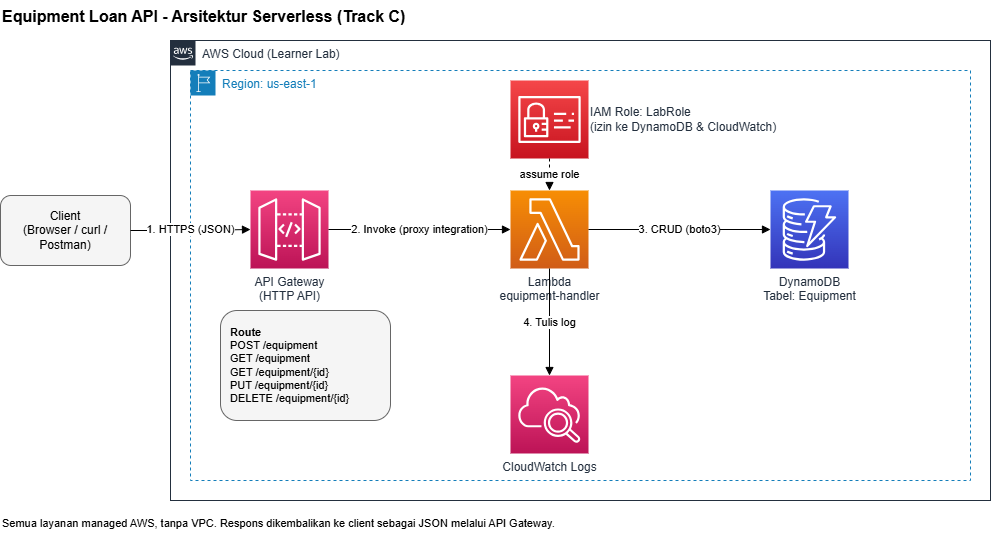

# Equipment Loan API

Aplikasi peminjaman alat berbasis serverless di AWS.
Track C (Serverless) - Tugas Individu Komputasi Awan, Week 12.

## Use case
Peminjaman alat: mencatat data alat, status ketersediaan, dan peminjamnya.

## Arsitektur
Client → Lambda Function URL → Lambda → Amazon S3 (+ CloudWatch Logs)



Detail desain: [docs/design-brief.md](docs/design-brief.md)

## Entitas & Penyimpanan
- **Storage:** Amazon S3 (1 objek JSON per alat pada prefix `equipment/{id}.json`)
- **Entitas `Equipment`:** `id`, `name`, `category`, `status`, `borrower`, `borrowed_at`, `due_date`

## Endpoint CRUD
| Method | Path | Fungsi |
|---|---|---|
| POST | /equipment | Tambah alat |
| GET | /equipment | Daftar alat |
| GET | /equipment/{id} | Detail alat |
| PUT | /equipment/{id} | Ubah data/status |
| DELETE | /equipment/{id} | Hapus alat |

## Struktur repository
```text
├── README.md
├── docs/            diagram arsitektur, design brief, bukti AWS
├── lambda/          kode fungsi Lambda
└── deployment/      rencana deployment
