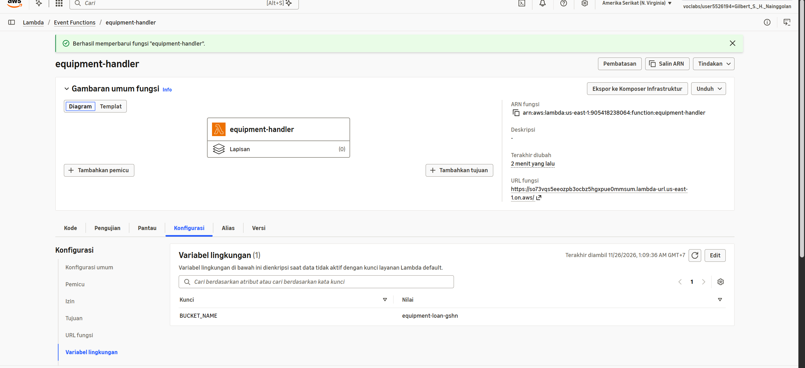
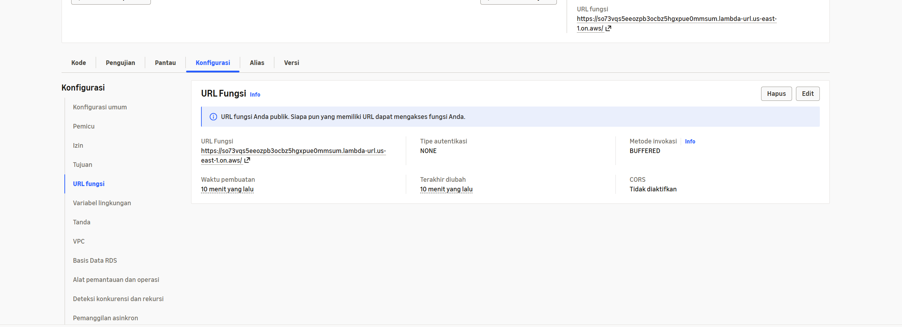
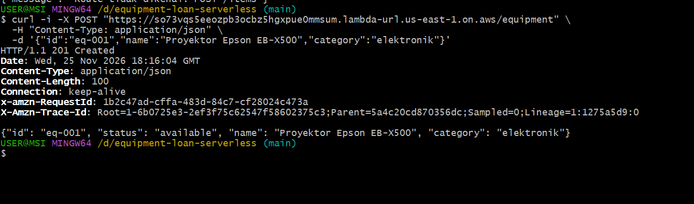
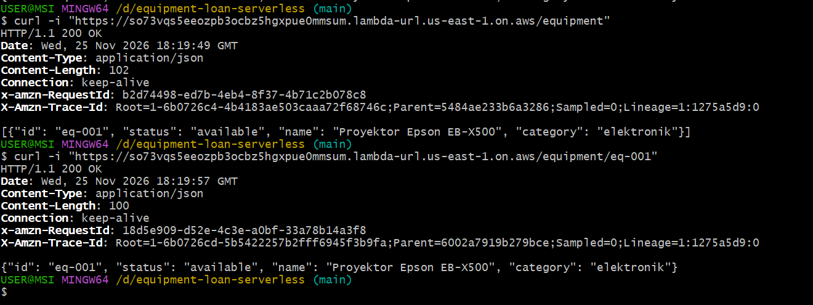
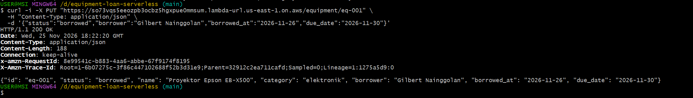
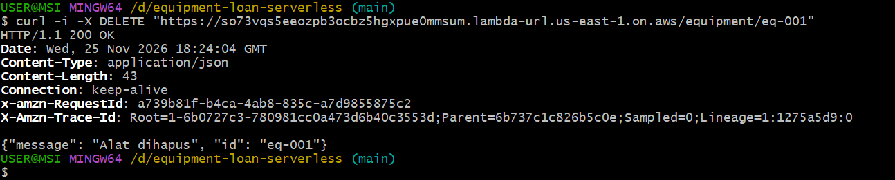

# Bukti AWS

Screenshot dan output uji dari infrastruktur AWS (`Learner Lab`, region `us-east-1`) untuk layanan **Equipment Loan Serverless** (`equipment-handler` + Amazon S3 `equipment-loan-gshn`).

## Daftar Bukti (Screenshot)

| File | Isi | Keterangan |
|---|---|---|
| `lambda-config.png` | Konfigurasi fungsi Lambda dan variabel lingkungan | Menampilkan fungsi `equipment-handler` (Python 3.12, timeout 10 detik) dengan environment variable `BUCKET_NAME = equipment-loan-gshn`. |
| `function-url.png` | Function URL publik | Menampilkan endpoint HTTPS `https://so73vqs5eeozpb3ocbz5hgxpue0mmsum.lambda-url.us-east-1.on.aws/` dengan tipe autentikasi `NONE` dan metode invokasi `BUFFERED`. |
| `curl-post-create.png` | Hasil uji `POST /equipment` | Pengujian penambahan data perangkat baru (`eq-001`) dengan respons status `201 Created`. |
| `curl-get-read.png` | Hasil uji `GET /equipment` dan `GET /equipment/{id}` | Pengujian pembacaan daftar seluruh perangkat dan detail perangkat `eq-001` dengan respons status `200 OK`. |
| `curl-put-update.png` | Hasil uji `PUT /equipment/{id}` | Pengujian pembaruan status peminjaman perangkat `eq-001` menjadi `borrowed` dengan respons status `200 OK`. |
| `curl-delete.png` | Hasil uji `DELETE /equipment/{id}` | Pengujian penghapusan data perangkat `eq-001` dari penyimpanan S3 dengan respons status `200 OK`. |

---

## Detail Infrastruktur & Konfigurasi

### 1. Konfigurasi AWS Lambda (`lambda-config.png`)


- **Nama Fungsi:** `equipment-handler`
- **ARN:** `arn:aws:lambda:us-east-1:905418238064:function:equipment-handler`
- **Environment Variable:** `BUCKET_NAME = equipment-loan-gshn`
- **Penjelasan & Keterangan:** Menghubungkan logika *backend* Python di AWS Lambda dengan *bucket* Amazon S3 `equipment-loan-gshn` secara dinamis tanpa menuliskan nama *bucket* secara keras (*hardcode*) di dalam kode sumber.

### 2. Endpoint HTTP Publik (`function-url.png`)


- **Function URL:** `https://so73vqs5eeozpb3ocbz5hgxpue0mmsum.lambda-url.us-east-1.on.aws/`
- **Tipe Autentikasi:** `NONE`
- **Metode Invokasi:** `BUFFERED`
- **Penjelasan & Keterangan:** Membuka akses langsung ke fungsi Lambda melalui protokol HTTPS standar sehingga klien dapat melakukan operasi CRUD tanpa memerlukan layanan Amazon API Gateway tambahan.

---

## Dokumentasi Pengujian Endpoint CRUD (`curl`)

### 1. Create — Tambah Data Peralatan (`curl-post-create.png`)


- **Penjelasan:** Menambahkan objek peralatan baru dengan ID `eq-001` ke dalam *bucket* S3 pada prefix `equipment/eq-001.json`.
- **Command:**
```bash
curl -i -X POST "[https://so73vqs5eeozpb3ocbz5hgxpue0mmsum.lambda-url.us-east-1.on.aws/equipment](https://so73vqs5eeozpb3ocbz5hgxpue0mmsum.lambda-url.us-east-1.on.aws/equipment)" \
  -H "Content-Type: application/json" \
  -d '{"id":"eq-001","name":"Proyektor Epson EB-X500","category":"elektronik"}'
```
- **Output:**
```http
HTTP/1.1 201 Created
Content-Type: application/json

{"id": "eq-001", "status": "available", "name": "Proyektor Epson EB-X500", "category": "elektronik"}
```
- **Keterangan:** Permintaan berhasil divalidasi oleh Lambda dan disimpan ke S3 dengan status awal otomatis `"available"`.

---

### 2. Read — Baca Daftar & Detail Peralatan (`curl-get-read.png`)


- **Penjelasan:** Mengambil seluruh daftar peralatan serta mengambil rincian satu peralatan spesifik berdasarkan ID (`eq-001`).
- **Command:**
```bash
# Ambil semua peralatan
curl -i "[https://so73vqs5eeozpb3ocbz5hgxpue0mmsum.lambda-url.us-east-1.on.aws/equipment](https://so73vqs5eeozpb3ocbz5hgxpue0mmsum.lambda-url.us-east-1.on.aws/equipment)"

# Ambil detail peralatan eq-001
curl -i "[https://so73vqs5eeozpb3ocbz5hgxpue0mmsum.lambda-url.us-east-1.on.aws/equipment/eq-001](https://so73vqs5eeozpb3ocbz5hgxpue0mmsum.lambda-url.us-east-1.on.aws/equipment/eq-001)"
```
- **Output:**
```http
HTTP/1.1 200 OK
Content-Type: application/json

[{"id": "eq-001", "status": "available", "name": "Proyektor Epson EB-X500", "category": "elektronik"}]
```
```http
HTTP/1.1 200 OK
Content-Type: application/json

{"id": "eq-001", "status": "available", "name": "Proyektor Epson EB-X500", "category": "elektronik"}
```
- **Keterangan:** Lambda berhasil memindai objek di bawah prefix `equipment/` dan membaca isi file JSON `eq-001` secara akurat dari Amazon S3.

---

### 3. Update — Peminjaman Peralatan (`curl-put-update.png`)


- **Penjelasan:** Memperbarui status peralatan `eq-001` menjadi dipinjam (`borrowed`) beserta informasi peminjam dan tanggal tenggat pengembalian.
- **Command:**
```bash
curl -i -X PUT "[https://so73vqs5eeozpb3ocbz5hgxpue0mmsum.lambda-url.us-east-1.on.aws/equipment/eq-001](https://so73vqs5eeozpb3ocbz5hgxpue0mmsum.lambda-url.us-east-1.on.aws/equipment/eq-001)" \
  -H "Content-Type: application/json" \
  -d '{"status":"borrowed","borrower":"Gilbert Nainggolan","borrowed_at":"2026-11-26","due_date":"2026-11-30"}'
```
- **Output:**
```http
HTTP/1.1 200 OK
Content-Type: application/json

{"id": "eq-001", "status": "borrowed", "name": "Proyektor Epson EB-X500", "category": "elektronik", "borrower": "Gilbert Nainggolan", "borrowed_at": "2026-11-26", "due_date": "2026-11-30"}
```
- **Keterangan:** Data lama (`name` dan `category`) tetap dipertahankan sementara atribut peminjaman berhasil digabungkan dan ditulis ulang ke S3.

---

### 4. Delete — Hapus Data Peralatan (`curl-delete.png`)


- **Penjelasan:** Menghapus data peralatan `eq-001` dari penyimpanan S3.
- **Command:**
```bash
curl -i -X DELETE "[https://so73vqs5eeozpb3ocbz5hgxpue0mmsum.lambda-url.us-east-1.on.aws/equipment/eq-001](https://so73vqs5eeozpb3ocbz5hgxpue0mmsum.lambda-url.us-east-1.on.aws/equipment/eq-001)"
```
- **Output:**
```http
HTTP/1.1 200 OK
Content-Type: application/json

{"message": "Alat dihapus", "id": "eq-001"}
```
- **Keterangan:** Objek `equipment/eq-001.json` berhasil dihapus secara permanen dari *bucket* S3 melalui handler `DELETE` pada fungsi Lambda.
